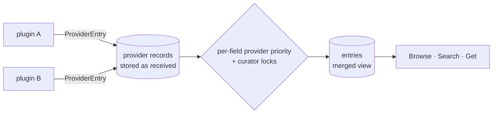

# The entry schema

meta's catalogue item is an **entry**: one series, novel, comic run or similar work. The schema is defined in [`proto/panelarr/metadata/v1/entry.proto`](../proto/panelarr/metadata/v1/entry.proto) (what plugins send) and [`proto/panelarr/meta/v1/meta.proto`](../proto/panelarr/meta/v1/meta.proto) (what meta serves). It is generic on purpose, so any provider (API, scraper or dump) can fill in whatever it knows.

## Two layers

- **`ProviderEntry`** is what one provider says about one item, keyed by `(provider, id)`. meta stores it as it arrived, including the provider's original record (`raw`). A new version replaces the old one.
- **`Entry`** is meta's merged record with its own ID. It links one or more provider records that share an external ID. Each field comes from the provider with the highest priority for that field, and a curator can lock a field. `field_sources` says where each field came from, and `sources` lists the provider records with their attribution.

## Fields

| Field | What |
|---|---|
| `type`, `status`, `content_rating` | Enums, each with the provider's raw string |
| `titles[]` | All titles: main, native, romanized, alternatives, titles per language. Each has `language` (BCP 47, script allowed: `ja-Latn`), `kind`, `is_primary`, free `traits`, `note` |
| `descriptions[]` | One per language, plain text, Markdown or HTML |
| `credits[]` | People and their roles (author, artist, editor, voice actor, ...) |
| `companies[]` | Publishers, magazines, imprints, licensors, studios, ... with roles |
| `licenses[]` | Licensing per language or region |
| `tags[]` | Tag assignments in the provider's order; genres are tags with `is_genre`. A tag's `path` lists its parents, root first; a tag is the same tag only with the same kind, path and name. Per entry: `weight`, `score`, `is_spoiler` |
| `relations[]` | Links to other entries (sequel, spin-off, adaptation, ...) |
| `adaptations[]` | The work in another medium (anime, live action, games, ...) |
| `items[]` | Known releases: chapters, volumes, issues |
| `progress` | `total`, `latest`, `final` as refs: "12 volumes", "chapter 108", "volume 12 (exact)" |
| `dates` | Announced, start, end as partial dates (a year may be all a provider knows) |
| `original_language` | BCP 47 |
| `images[]` | Covers, banners, ... with size, blurhash/thumbhash placeholders and size variants |
| `links[]` | Official sites, stores, reading and streaming links, wikis, socials |
| `external_ids[]` | The same work at other providers: `anilist`, `mal`, `mangaupdates`, `kitsu`, `mangadex`, `isbn`, ... |
| `stats` | One provider's rating (0–100), popularity and rank. Never mixed across providers |
| `state` | `active`, `merged` (with `merged_into`), `removed` |

**Shared entities.** People, companies and tags are stored once and referenced from many entries. Each has its own external IDs, so providers that know IDs (for example a staff database) can link names that other providers only know as strings.

## Enums keep the raw value

Every enum value travels with the provider's original string (`raw_type`, `raw_role`, ...). A provider value outside our list maps to `OTHER` or `UNKNOWN`, and the original stays. Adding enum values later is not a breaking change.

## Provider keys

`ExternalId.provider` is a short lower-case key. Well-known keys: `mangabaka`, `anilist`, `mal`, `mangaupdates`, `kitsu`, `animeplanet`, `ann`, `shikimori`, `mangadex`, `comicvine`, `isbn`. The list is open.

## Changes from the first design

The schema started from a design discussion in Panelarr's planning repo ([metadata schema](https://github.com/panelarr/knowledge/blob/main/contracts/metadata-schema.md)). While turning it into protos:

- `PartialDate` gained `estimated`, because providers flag estimated start and end dates.
- `CompanyCredit` gained `language`, for publishers that are credited per market (original, English, ...).
- `Stats` splits popularity into `popularity` (a score, higher is better) and `popularity_rank` (a position, 1 is best), because providers report one or the other.
- `ProviderEntry` gained `url` (the record's page at the provider) and `updated_at` (when the provider last changed it).
- `Relation` carries the target as an external ID plus meta's `entry_id` once meta knows it, and a display `title`.
- Persons, companies and tags carry meta's `id`, empty in plugin records and set by meta when serving.
